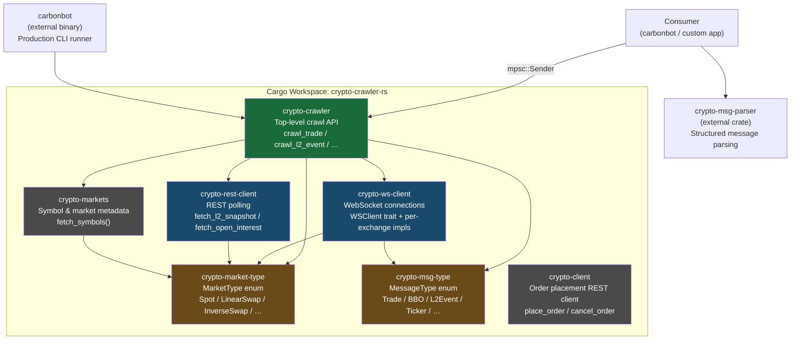
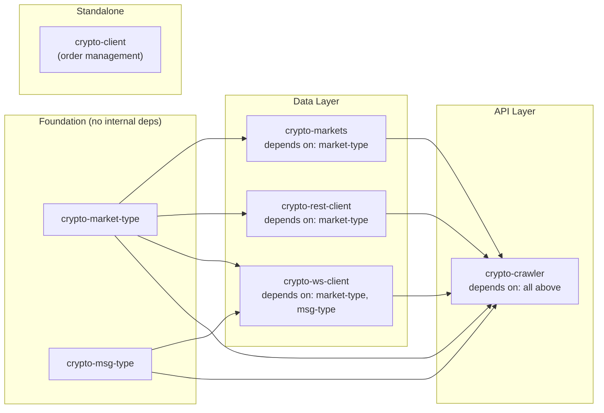

> Historical archive captured 2026-10-13 from source base `71cece019a390f5c0fbf4b33f4dddc3ac461ef8e`. Original document SHA256: `5deb406dbd9bcfbb5c45c4e24023c6f4d6835f30992e4e3388332493e8b3a153`. This superseded guide is not evidence of current capability support. Use [the source-reviewed guide](../ayu-develop.md).

# Architecture

> **See also**: [README](.././README.md) · [Workflow](.././workflow.md) · [State Management](.././state-management.md) · [Development](.././development.md)

## System Architecture Diagram

---

## Trading Paradigm & Key Features

This is a **pure market-data crawler**, not a trading engine. The table below reflects its scope.

| Capability | Support | Notes |
|---|---|---|
| Real-time trade feed | Yes | WebSocket, all major exchanges |
| L2 orderbook (incremental) | Yes | WebSocket `L2Event` channel |
| L2 orderbook (snapshot) | Yes | REST polling via `crawl_l2_snapshot` |
| L2 top-K snapshots | Yes | WebSocket `L2TopK` |
| L3 orderbook (incremental) | Yes | Bitfinex, Bitstamp, CoinbasePro, KuCoin only |
| L3 orderbook (snapshot) | Yes | REST polling |
| Best Bid & Offer (BBO) | Yes | WebSocket level-1 |
| 24hr rolling ticker | Yes | WebSocket `Ticker` |
| Candlestick / OHLCV | Yes | WebSocket, 1s – 3m intervals |
| Funding rates | Yes | WebSocket, perpetual swaps only |
| Open interest | Yes | REST polling |
| Order placement | N/A | `crypto-client` crate exists but is separate |
| Backtesting | N/A | No simulation engine |
| Strategy execution | N/A | Data delivery only |
| Portfolio management | N/A | Not in scope |
| Risk management | N/A | Not in scope |

---

## Core Components

### `crypto-crawler` — Top-Level API

**Source**: [`crypto-crawler/src/lib.rs`](../../crypto-crawler/src/lib.rs)

The public entry point. Provides `async` functions matching each `MessageType`. Routes calls to exchange-specific crawler modules or the shared generic `crawl_event` / `crawl_snapshot` dispatcher.

Key public functions:

| Function | Transport | Description |
|---|---|---|
| `crawl_trade` | WebSocket | Tick-by-tick trade events |
| `crawl_l2_event` | WebSocket | Incremental L2 orderbook updates |
| `crawl_l2_snapshot` | REST | Full L2 orderbook snapshots |
| `crawl_l2_topk` | WebSocket | Top-K L2 snapshots |
| `crawl_l3_event` | WebSocket | Incremental L3 orderbook updates |
| `crawl_l3_snapshot` | REST | Full L3 orderbook snapshots |
| `crawl_bbo` | WebSocket | Best Bid & Offer |
| `crawl_ticker` | WebSocket | 24hr rolling window ticker |
| `crawl_candlestick` | WebSocket | OHLCV candlesticks |
| `crawl_funding_rate` | WebSocket | Perpetual swap funding rates |
| `crawl_open_interest` | REST | Aggregate open interest |
| `subscribe_symbol` | WebSocket | Multi-type subscription for a single symbol |
| `fetch_symbols_retry` | REST | List valid symbols with retry + backoff |

**Source**: [`crypto-crawler/src/crawlers/mod.rs`](../../crypto-crawler/src/crawlers/mod.rs)  
Exchange-specific modules: `binance`, `bitmex`, `deribit`, `huobi`, `kucoin`, `okx`, `zb`, `zbg`.  
Shared dispatcher: [`crypto-crawler/src/crawlers/utils.rs`](../../crypto-crawler/src/crawlers/utils.rs)

---

### `crypto-ws-client` — WebSocket Client Library

**Source**: [`crypto-ws-client/src/lib.rs`](../../crypto-ws-client/src/lib.rs)

Provides the `WSClient` trait and concrete implementations for every supported exchange. Handles:

- TLS connections via `tokio-tungstenite` with `rustls`
- SOCKS5 proxy support via `fast-socks5`
- Rate-limited message sending via `governor`
- Gzip/deflate decompression via `flate2`
- Automatic reconnection on error
- Heartbeat / ping management

**`WSClient` trait** — [`crypto-ws-client/src/common/ws_client.rs`](../../crypto-ws-client/src/common/ws_client.rs):

High-level methods: `subscribe_trade`, `subscribe_bbo`, `subscribe_orderbook`, `subscribe_orderbook_topk`, `subscribe_l3_orderbook`, `subscribe_ticker`, `subscribe_candlestick`

Low-level methods: `subscribe(topics)`, `unsubscribe(topics)`, `send(commands)`, `run()`, `close()`

**Internal infrastructure**:
- [`crypto-ws-client/src/common/ws_client_internal.rs`](../../crypto-ws-client/src/common/ws_client_internal.rs) — connection + run-loop state machine
- [`crypto-ws-client/src/common/message_handler.rs`](../../crypto-ws-client/src/common/message_handler.rs) — `MessageHandler` trait, `MiscMessage` enum
- [`crypto-ws-client/src/common/connect_async.rs`](../../crypto-ws-client/src/common/connect_async.rs) — async TCP/TLS connect with proxy

**Exchange clients** (in [`crypto-ws-client/src/clients/`](../../crypto-ws-client/src/clients/)):

`binance`, `binance_option`, `bitfinex`, `bitget`, `bithumb`, `bitmex`, `bitstamp`, `bitz`, `bybit`, `coinbase_pro`, `deribit`, `dydx`, `ftx`, `gate`, `huobi`, `kraken`, `kucoin`, `mexc`, `okx`, `zb`, `zbg`

---

### `crypto-rest-client` — REST Client

**Source**: [`crypto-rest-client/Cargo.toml`](../../crypto-rest-client/Cargo.toml)

Polling-based client for data unavailable via WebSocket:
- `fetch_l2_snapshot(exchange, market_type, symbol, depth)` — full orderbook
- `fetch_l3_snapshot(exchange, market_type, symbol)` — raw orderbook
- `fetch_open_interest(exchange, market_type)` — aggregate OI

Uses `reqwest` with SOCKS5 proxy support and `regex`-based response parsing.

---

### `crypto-markets` — Market Metadata

**Source**: [`crypto-markets/Cargo.toml`](../../crypto-markets/Cargo.toml)

REST library to retrieve available trading symbols from each exchange via `fetch_symbols(exchange, market_type) -> Result<Vec<String>>`. Used by `crypto-crawler` for automatic symbol discovery.

---

### `crypto-market-type` — MarketType Enum

**Source**: [`crypto-market-type/src/lib.rs`](../../crypto-market-type/src/lib.rs)

Defines the `MarketType` enum (`Spot`, `LinearFuture`, `InverseFuture`, `LinearSwap`, `InverseSwap`, `AmericanOption`, `EuropeanOption`, `QuantoFuture`, `QuantoSwap`, `Move`, `BVOL`) and `get_market_types(exchange)` helper. Used by every other crate.

---

### `crypto-msg-type` — MessageType Enum

**Source**: [`crypto-msg-type/src/lib.rs`](../../crypto-msg-type/src/lib.rs)

Defines `MessageType` (`Trade`, `L2Event`, `L2Snapshot`, `L2TopK`, `L3Event`, `L3Snapshot`, `BBO`, `Ticker`, `Candlestick`, `FundingRate`, `OpenInterest`, `LongShortRatio`, `TakerVolume`, `Other`) and the `get_ws_commands(exchange, msg_types, symbols, subscribe, configs)` function that translates abstract subscriptions into exchange-specific JSON commands.

---

### `crypto-client` — Order Placement

**Source**: [`crypto-client/Cargo.toml`](../../crypto-client/Cargo.toml)

A REST client for placing and cancelling orders. Separate from the data-crawling crates and not a dependency of `crypto-crawler`.

---

## Module Dependency Diagram

