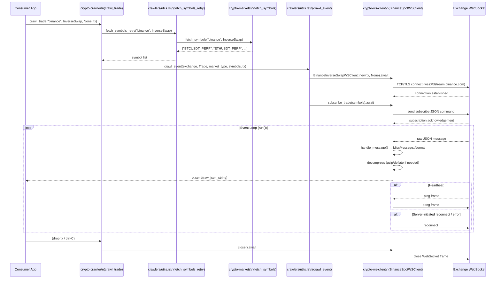
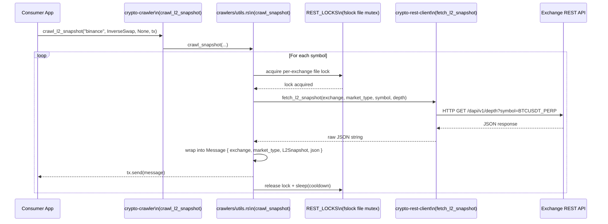

> Historical archive captured 2026-10-13 from source base `71cece019a390f5c0fbf4b33f4dddc3ac461ef8e`. Original document SHA256: `81130c8e7c7da6aa84c4ec72d515d511be448f022a9dfb4b851c3b1f18eeec5d`. This superseded guide is not evidence of current capability support. Use [the source-reviewed guide](../ayu-develop.md).

# Workflow

> **See also**: [README](.././README.md) · [Architecture](.././architecture.md) · [State Management](.././state-management.md) · [Development](.././development.md)

## Crawling Pipeline — Sequence Diagram

The diagram below shows the full lifecycle for a WebSocket-based crawler (e.g., `crawl_trade`). REST-based crawlers (`crawl_l2_snapshot`, `crawl_open_interest`) follow a simpler polling loop and are shown separately.



---

## REST Snapshot Polling Flow



---

## Symbol Auto-Discovery Flow

When `symbols` is `None`, `crypto-crawler` launches a background task to refresh the symbol list every hour:

```
crawl_trade("binance", Spot, None, tx)
    │
    ├── Initial: fetch_symbols_retry("binance", Spot) → ["BTCUSDT", "ETHUSDT", ...]
    │
    └── Spawn background task
            loop every 3600s:
                new_symbols = fetch_symbols_retry(...)
                if new_symbols != current_symbols:
                    resubscribe WSClient with new_symbols
```

Source: [`crypto-crawler/src/crawlers/utils.rs`](../../crypto-crawler/src/crawlers/utils.rs)

---

## WebSocket Message Handling

Each exchange client implements the `MessageHandler` trait defined in [`crypto-ws-client/src/common/message_handler.rs`](../../crypto-ws-client/src/common/message_handler.rs).

The `handle_message(&str) -> MiscMessage` method classifies each incoming frame:

| `MiscMessage` Variant | Meaning | Action in `run()` |
|---|---|---|
| `Normal` | Standard market data JSON | Forward raw string to consumer via `tx.send()` |
| `Mutated(String)` | Handler transformed the payload (e.g., Bitfinex array → object) | Forward mutated string |
| `WebSocket(Message)` | Handler wants to send a reply (e.g., custom pong) | Write frame to exchange |
| `Pong` | Server pong received | Reset heartbeat timer |
| `Reconnect` | Exchange requested reconnect | Drop connection, reconnect |
| `Other` | Subscription acks, non-data frames | Discard silently |

---

## Rate-Limit & Concurrency Control

To avoid HTTP 429 errors when fetching snapshots or symbol lists from REST APIs, `crypto-crawler` uses:

1. **Per-exchange, per-market-type cooldown times** — configured in `crawlers/utils.rs` (e.g., Binance: 500 ms, BitMEX: 2000 ms, CoinbasePro: 100 ms).
2. **`fslock` file-based mutexes** (`REST_LOCKS`) — coordinate across multiple OS processes sharing the same exchange quota.
3. **Exponential backoff** in `fetch_symbols_retry` — doubles the sleep interval on each failure up to `REST_RETRY_COUNT` attempts (default: 5).

Source: [`crypto-crawler/src/crawlers/utils.rs`](../../crypto-crawler/src/crawlers/utils.rs)

---

## Data Flow Summary

```
Exchange WebSocket/REST
        │  raw JSON
        ▼
crypto-ws-client / crypto-rest-client
        │  handle_message / HTTP parse
        ▼
Message { exchange, market_type, msg_type, symbol?, received_at, json }
        │  mpsc::Sender<Message>
        ▼
Consumer (carbonbot, custom app)
        │  (optional)
        ▼
crypto-msg-parser  →  structured trade / orderbook / ticker structs
```

Messages are always **raw and unparsed** inside the `json` field. The crawler's contract is to deliver them reliably and in order, without modification (except for Bitfinex array-format normalization handled inside the ws-client).

---

## See Also

- [`crypto-crawler/src/lib.rs`](../../crypto-crawler/src/lib.rs) — all public crawl functions
- [`crypto-ws-client/src/common/ws_client.rs`](../../crypto-ws-client/src/common/ws_client.rs) — `WSClient` trait
- [`crypto-ws-client/src/common/ws_client_internal.rs`](../../crypto-ws-client/src/common/ws_client_internal.rs) — internal run-loop
- [`crypto-ws-client/src/common/message_handler.rs`](../../crypto-ws-client/src/common/message_handler.rs) — `MiscMessage` enum
- [State Management](.././state-management.md) — `Message`, `MarketType`, `MessageType` data models
