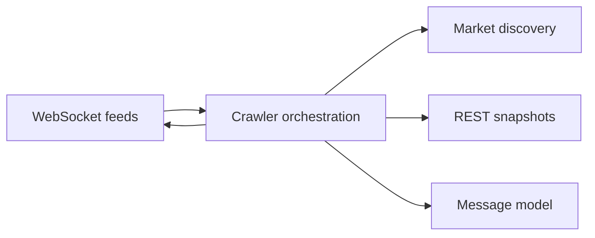
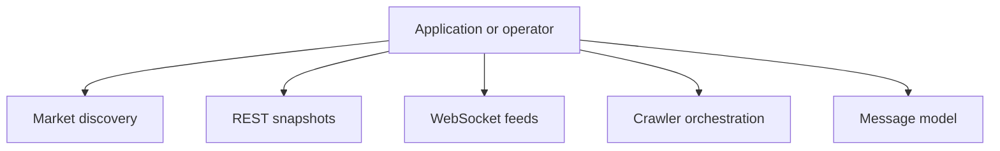
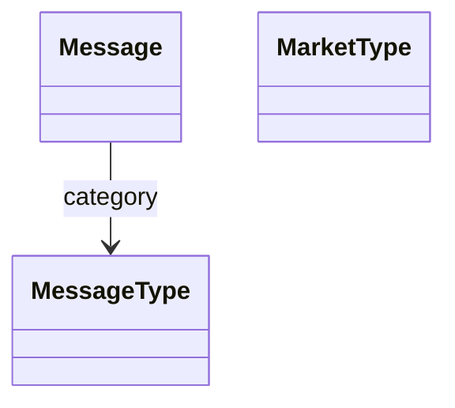
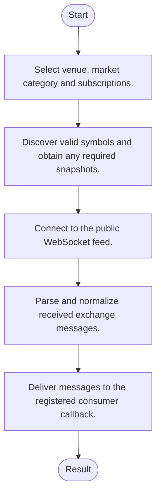
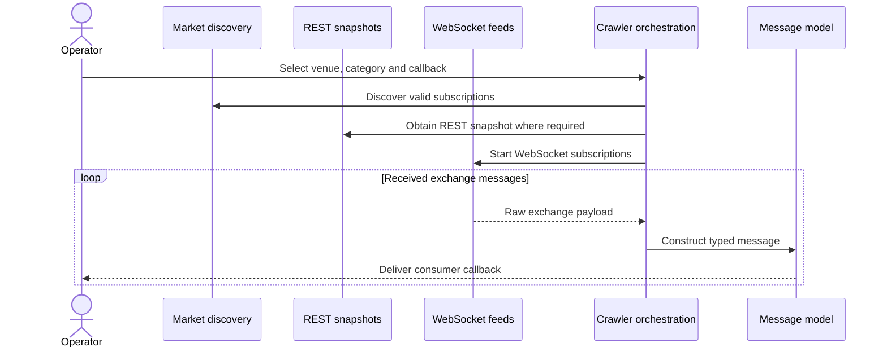
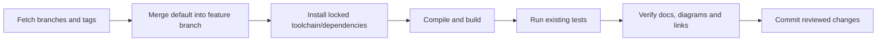
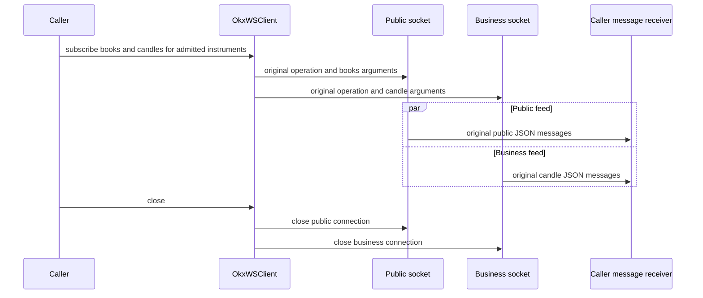

# crypto-crawler-rs: architecture, features and workflows

Updated: 2026-10-12 · Branch: `feature/ayu_develop` · Source snapshot: `f3425a0`

[Development and layout](development.md) · [Validation evidence](validation.md) · [HTML edition](ayu-develop.html)

## Purpose and scope

A multi-crate Rust cryptocurrency market-data toolkit. Venue crawlers combine market discovery, REST snapshots and WebSocket messages, parse exchange payloads and expose normalized message types. It also includes REST clients and a blocking unified HTTP client.

## Features

- Independent spot, inverse, linear, option and swap market categories.
- REST and WebSocket adapters cover multiple exchanges.
- Callbacks expose streaming messages to consumer applications.
- Market and symbol utilities support feed setup and filtering.
- The matching protobuf runtime is pinned for the externally generated crypto-message schema.

## Components and responsibilities

| Component | Responsibility | Implementation |
| --- | --- | --- |
| Market discovery | Retrieves supported markets and contract metadata | [crypto-markets/src/lib.rs](../crypto-markets/src/lib.rs) |
| REST snapshots | Fetches public exchange snapshots and historical resources | [crypto-rest-client/src/lib.rs](../crypto-rest-client/src/lib.rs) |
| WebSocket feeds | Maintains venue-specific streaming connections | [crypto-ws-client/src/lib.rs](../crypto-ws-client/src/lib.rs) |
| Crawler orchestration | Coordinates discovery, connections and message callbacks | [crypto-crawler/src/lib.rs](../crypto-crawler/src/lib.rs) |
| Message model | Classifies messages and stores venue/time/payload information | [crypto-crawler/src/msg.rs](../crypto-crawler/src/msg.rs) |

## Architecture and boundaries

The following view shows the principal responsibilities and their data-flow relationship. It is a conceptual architecture view; each implementation link above identifies the owning source. Native or external services retain their own lifecycle and configuration.



### Component ownership

The boundaries below distinguish entry points from their state/model and integration responsibilities. Data validation, numerical semantics and external protocol handling belong in the owning modules rather than in documentation or deployment scripts.



## Types and relationships

This diagram names types present in the linked source. Edges describe the documented relationship; they do not imply additional inheritance.



- [`Message`](../crypto-crawler/src/msg.rs)
- [`MessageType`](../crypto-msg-type/src/lib.rs)
- [`MarketType`](../crypto-market-type/src/lib.rs)

## Runtime workflow

1. Select venue, market category and subscriptions.
2. Discover valid symbols and obtain any required snapshots.
3. Connect to the public WebSocket feed.
4. Parse and normalize received exchange messages.
5. Deliver messages to the registered consumer callback.



## Sequence of a typical operation

This sequence expands the responsibility flow described above. The named participants correspond to the component table; error handling and any service-specific prerequisites remain part of the implementation.



## Development and verification workflow

Sync the upstream refs, merge the actual default branch into `feature/ayu_develop`, resolve conflicts, install the documented environment and run the existing build/test commands. Keep lockfiles and source changes together so another checkout can reproduce the environment.



### Commands

```sh
cargo build --workspace --all-targets --locked
cargo test --workspace --locked
```

The exact commands executed, interpreter/compiler versions, pass/fail counts and any prerequisites are recorded in [validation.md](validation.md). A syntax-only pass is reported separately from a package/native build and from runtime tests.

## Source navigation

These links refer to files in this checkout. They remain useful when the repository is opened locally; the source snapshot above identifies the revision used for this guide.

- [crypto-markets/src/lib.rs](../crypto-markets/src/lib.rs)
- [crypto-rest-client/src/lib.rs](../crypto-rest-client/src/lib.rs)
- [crypto-ws-client/src/lib.rs](../crypto-ws-client/src/lib.rs)
- [crypto-crawler/src/lib.rs](../crypto-crawler/src/lib.rs)
- [crypto-crawler/src/msg.rs](../crypto-crawler/src/msg.rs)
- [crypto-msg-type/src/lib.rs](../crypto-msg-type/src/lib.rs)
- [crypto-market-type/src/lib.rs](../crypto-market-type/src/lib.rs)
- [.config/nextest.toml](../.config/nextest.toml)
- [Cargo.toml](../Cargo.toml)
- [crypto-client/Cargo.toml](../crypto-client/Cargo.toml)
- [crypto-client/src/lib.rs](../crypto-client/src/lib.rs)
- [crypto-crawler/Cargo.toml](../crypto-crawler/Cargo.toml)
- [crypto-crawler/src/crawlers/binance.rs](../crypto-crawler/src/crawlers/binance.rs)
- [crypto-crawler/src/crawlers/bitmex.rs](../crypto-crawler/src/crawlers/bitmex.rs)
- [crypto-crawler/src/crawlers/deribit.rs](../crypto-crawler/src/crawlers/deribit.rs)

## Current endpoint routing and supplied fixture admission

The current [OKX client](../crypto-ws-client/src/clients/okx.rs) owns separate public/business sockets unless a caller provides an explicit single-endpoint override. The subscription translator preserves the original operation and instrument IDs when partitioning commands. Candles use business; books, tickers and ordinary public channels use public. Both sockets run concurrently and both close during teardown. [Binance](../crypto-ws-client/src/clients/binance.rs) likewise separates its current linear-futures public and market channels.



[Listed-contract fixture support](../test_support/listed_contracts.rs) queries actual metadata for the original underlying, settlement family and market type. Quarterly futures remain preferred when the original fixture was quarterly. Options prefer the original strike and then the nearest admitted strike while retaining call/put side. It does not return replay data or drop instruments because a venue no longer lists them. The unchanged supplied assertions still validate real messages. The [current funding parser patch](../vendor/crypto-msg-parser/src/exchanges/okx/okx_v5.rs) maps an omitted optional forecast to `None`, with [upstream license](../vendor/crypto-msg-parser/LICENSE) and [modification notice](../vendor/crypto-msg-parser/MODIFICATIONS.md).

Coinbase's public Level2 path uses its documented 50 ms batch feed; its Full/Level3 subscription returns an authentication error without account credentials. BitMEX's original futures fixtures are settled. Build/unit success and each dated live integration outcome are separately recorded in [validation](validation.md); neither a current socket acknowledgement nor a substituted market family is counted as a passing original data assertion.
