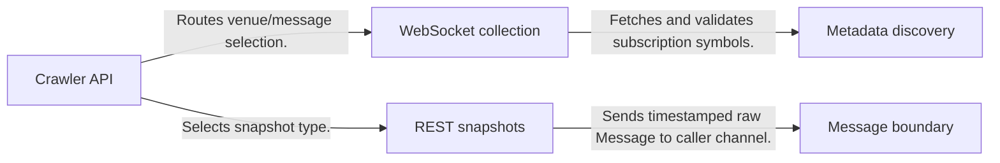
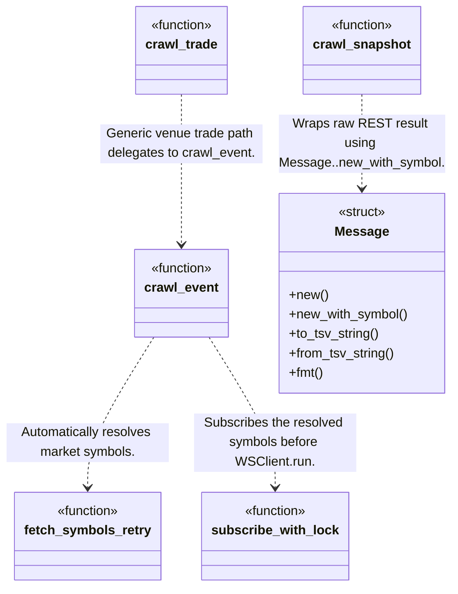
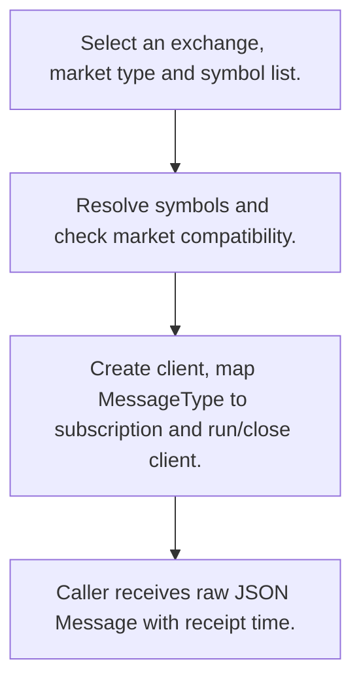
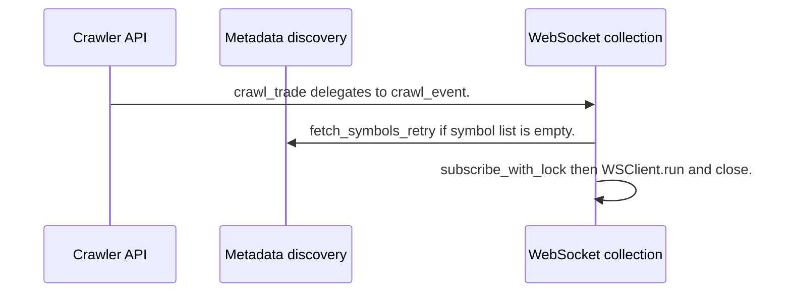

# Crypto Crawler Rust: workflow, design and architecture

Updated: **2026-10-13**
Reviewed Git hash: `71cece019a390f5c0fbf4b33f4dddc3ac461ef8e`
Branch: `feature/ayu_develop`
Source diff SHA256: `e3b0c44298fc1c149afbf4c8996fb92427ae41e4649b934ca495991b7852b855`
Scope: **Market data toolkit** / Maintenance: **active**
Languages: Rust

[HTML edition](ayu-develop.html) / [Development](development.md) / [Historical validation](validation.md) / [Full system comparison](../../docs/index.html)

## Purpose and scope

Collects public crypto exchange streams and REST snapshots into timestamped raw-message envelopes; a data acquisition workspace rather than a strategy or matching engine.

## Features and support boundaries

Native = implemented here. Integration = supplied through a named host/API. Limited = material restriction. Not provided = evidenced scope exclusion. Unverified = support/absence not established. Not applicable = outside this artifact type.

| Capability | Status | Implementation and limits | Source |
|---|---|---|---|
| Backtesting | Unverified | Not established by the inspected implementation boundaries; no absence or production claim is made. | Not applicable to this repository scope. |
| Live execution | Unverified | Not established by the inspected implementation boundaries; no absence or production claim is made. | Not applicable to this repository scope. |
| Paper trading | Unverified | Not established by the inspected implementation boundaries; no absence or production claim is made. | Not applicable to this repository scope. |
| Event driven | Native | Subscription callbacks/client loops emit asynchronous feed messages; this is feed handling rather than trading events. | [crawl_event](../crypto-crawler/src/crawlers/utils.rs) ([L705](https://github.com/alexcwyu/crypto-crawler-rs/blob/71cece019a390f5c0fbf4b33f4dddc3ac461ef8e/crypto-crawler/src/crawlers/utils.rs#L705)) / [subscribe_with_lock](../crypto-crawler/src/crawlers/utils.rs) ([L318](https://github.com/alexcwyu/crypto-crawler-rs/blob/71cece019a390f5c0fbf4b33f4dddc3ac461ef8e/crypto-crawler/src/crawlers/utils.rs#L318)) |
| Vectorized | Unverified | Not established by the inspected implementation boundaries; no absence or production claim is made. | Not applicable to this repository scope. |
| Order management | Unverified | Not established by the inspected implementation boundaries; no absence or production claim is made. | Not applicable to this repository scope. |
| Order types | Unverified | Not established by the inspected implementation boundaries; no absence or production claim is made. | Not applicable to this repository scope. |
| Multi venue | Native | Public Rust acquisition API routes multiple crypto venues and emits raw payload envelopes. | [crawl_trade](../crypto-crawler/src/lib.rs) ([L223](https://github.com/alexcwyu/crypto-crawler-rs/blob/71cece019a390f5c0fbf4b33f4dddc3ac461ef8e/crypto-crawler/src/lib.rs#L223)) / [crawl_l2_event](../crypto-crawler/src/lib.rs) ([L243](https://github.com/alexcwyu/crypto-crawler-rs/blob/71cece019a390f5c0fbf4b33f4dddc3ac461ef8e/crypto-crawler/src/lib.rs#L243)) / [crawl_event](../crypto-crawler/src/crawlers/utils.rs) ([L705](https://github.com/alexcwyu/crypto-crawler-rs/blob/71cece019a390f5c0fbf4b33f4dddc3ac461ef8e/crypto-crawler/src/crawlers/utils.rs#L705)) / [Message](../crypto-crawler/src/msg.rs) ([L12](https://github.com/alexcwyu/crypto-crawler-rs/blob/71cece019a390f5c0fbf4b33f4dddc3ac461ef8e/crypto-crawler/src/msg.rs#L12)) |
| Crypto | Native | Public Rust acquisition API routes multiple crypto venues and emits raw payload envelopes. | [crawl_trade](../crypto-crawler/src/lib.rs) ([L223](https://github.com/alexcwyu/crypto-crawler-rs/blob/71cece019a390f5c0fbf4b33f4dddc3ac461ef8e/crypto-crawler/src/lib.rs#L223)) / [crawl_l2_event](../crypto-crawler/src/lib.rs) ([L243](https://github.com/alexcwyu/crypto-crawler-rs/blob/71cece019a390f5c0fbf4b33f4dddc3ac461ef8e/crypto-crawler/src/lib.rs#L243)) / [crawl_event](../crypto-crawler/src/crawlers/utils.rs) ([L705](https://github.com/alexcwyu/crypto-crawler-rs/blob/71cece019a390f5c0fbf4b33f4dddc3ac461ef8e/crypto-crawler/src/crawlers/utils.rs#L705)) / [Message](../crypto-crawler/src/msg.rs) ([L12](https://github.com/alexcwyu/crypto-crawler-rs/blob/71cece019a390f5c0fbf4b33f4dddc3ac461ef8e/crypto-crawler/src/msg.rs#L12)) |
| Equities | Unverified | Not established by the inspected implementation boundaries; no absence or production claim is made. | Not applicable to this repository scope. |
| Futures | Limited | Market-family map includes crypto futures/swaps and Deribit European options; endpoint/contract availability is not proven by the map. | [get_market_types](../crypto-market-type/src/lib.rs) ([L53](https://github.com/alexcwyu/crypto-crawler-rs/blob/71cece019a390f5c0fbf4b33f4dddc3ac461ef8e/crypto-market-type/src/lib.rs#L53)) |
| Options | Limited | Market-family map includes crypto futures/swaps and Deribit European options; endpoint/contract availability is not proven by the map. | [get_market_types](../crypto-market-type/src/lib.rs) ([L53](https://github.com/alexcwyu/crypto-crawler-rs/blob/71cece019a390f5c0fbf4b33f4dddc3ac461ef8e/crypto-market-type/src/lib.rs#L53)) |
| Forex | Unverified | Not established by the inspected implementation boundaries; no absence or production claim is made. | Not applicable to this repository scope. |
| Strategy api | Unverified | Not established by the inspected implementation boundaries; no absence or production claim is made. | Not applicable to this repository scope. |
| Optimization | Unverified | Not established by the inspected implementation boundaries; no absence or production claim is made. | Not applicable to this repository scope. |
| Machine learning | Unverified | Not established by the inspected implementation boundaries; no absence or production claim is made. | Not applicable to this repository scope. |
| Reinforcement learning | Unverified | Not established by the inspected implementation boundaries; no absence or production claim is made. | Not applicable to this repository scope. |
| Portfolio | Unverified | Not established by the inspected implementation boundaries; no absence or production claim is made. | Not applicable to this repository scope. |
| Risk management | Unverified | Not established by the inspected implementation boundaries; no absence or production claim is made. | Not applicable to this repository scope. |
| Performance analytics | Unverified | Not established by the inspected implementation boundaries; no absence or production claim is made. | Not applicable to this repository scope. |
| Historical data | Limited | Message supports TSV encode/decode for caller-managed files; inspected snapshot collector retrieves current depth, not a maintained historical store. | [Message](../crypto-crawler/src/msg.rs) ([L12](https://github.com/alexcwyu/crypto-crawler-rs/blob/71cece019a390f5c0fbf4b33f4dddc3ac461ef8e/crypto-crawler/src/msg.rs#L12)) / [crawl_snapshot](../crypto-crawler/src/crawlers/utils.rs) ([L106](https://github.com/alexcwyu/crypto-crawler-rs/blob/71cece019a390f5c0fbf4b33f4dddc3ac461ef8e/crypto-crawler/src/crawlers/utils.rs#L106)) |
| Streaming data | Native | Public Rust acquisition API routes multiple crypto venues and emits raw payload envelopes. | [crawl_trade](../crypto-crawler/src/lib.rs) ([L223](https://github.com/alexcwyu/crypto-crawler-rs/blob/71cece019a390f5c0fbf4b33f4dddc3ac461ef8e/crypto-crawler/src/lib.rs#L223)) / [crawl_l2_event](../crypto-crawler/src/lib.rs) ([L243](https://github.com/alexcwyu/crypto-crawler-rs/blob/71cece019a390f5c0fbf4b33f4dddc3ac461ef8e/crypto-crawler/src/lib.rs#L243)) / [crawl_event](../crypto-crawler/src/crawlers/utils.rs) ([L705](https://github.com/alexcwyu/crypto-crawler-rs/blob/71cece019a390f5c0fbf4b33f4dddc3ac461ef8e/crypto-crawler/src/crawlers/utils.rs#L705)) / [Message](../crypto-crawler/src/msg.rs) ([L12](https://github.com/alexcwyu/crypto-crawler-rs/blob/71cece019a390f5c0fbf4b33f4dddc3ac461ef8e/crypto-crawler/src/msg.rs#L12)) |
| Persistence | Limited | Message supports TSV encode/decode for caller-managed files; inspected snapshot collector retrieves current depth, not a maintained historical store. | [Message](../crypto-crawler/src/msg.rs) ([L12](https://github.com/alexcwyu/crypto-crawler-rs/blob/71cece019a390f5c0fbf4b33f4dddc3ac461ef8e/crypto-crawler/src/msg.rs#L12)) / [crawl_snapshot](../crypto-crawler/src/crawlers/utils.rs) ([L106](https://github.com/alexcwyu/crypto-crawler-rs/blob/71cece019a390f5c0fbf4b33f4dddc3ac461ef8e/crypto-crawler/src/crawlers/utils.rs#L106)) |
| Data pipeline | Native | Public Rust acquisition API routes multiple crypto venues and emits raw payload envelopes. | [crawl_trade](../crypto-crawler/src/lib.rs) ([L223](https://github.com/alexcwyu/crypto-crawler-rs/blob/71cece019a390f5c0fbf4b33f4dddc3ac461ef8e/crypto-crawler/src/lib.rs#L223)) / [crawl_l2_event](../crypto-crawler/src/lib.rs) ([L243](https://github.com/alexcwyu/crypto-crawler-rs/blob/71cece019a390f5c0fbf4b33f4dddc3ac461ef8e/crypto-crawler/src/lib.rs#L243)) / [crawl_event](../crypto-crawler/src/crawlers/utils.rs) ([L705](https://github.com/alexcwyu/crypto-crawler-rs/blob/71cece019a390f5c0fbf4b33f4dddc3ac461ef8e/crypto-crawler/src/crawlers/utils.rs#L705)) / [Message](../crypto-crawler/src/msg.rs) ([L12](https://github.com/alexcwyu/crypto-crawler-rs/blob/71cece019a390f5c0fbf4b33f4dddc3ac461ef8e/crypto-crawler/src/msg.rs#L12)) |
| Web ui | Unverified | Not established by the inspected implementation boundaries; no absence or production claim is made. | Not applicable to this repository scope. |
| Cli | Unverified | Not established by the inspected implementation boundaries; no absence or production claim is made. | Not applicable to this repository scope. |
| Monitoring | Limited | Collection records received_at and logs failures/backoff; no trading/account monitoring is established. | [Message](../crypto-crawler/src/msg.rs) ([L12](https://github.com/alexcwyu/crypto-crawler-rs/blob/71cece019a390f5c0fbf4b33f4dddc3ac461ef8e/crypto-crawler/src/msg.rs#L12)) / [fetch_symbols_retry](../crypto-crawler/src/crawlers/utils.rs) ([L15](https://github.com/alexcwyu/crypto-crawler-rs/blob/71cece019a390f5c0fbf4b33f4dddc3ac461ef8e/crypto-crawler/src/crawlers/utils.rs#L15)) |
| Extension api | Native | Public Rust acquisition API routes multiple crypto venues and emits raw payload envelopes. | [crawl_trade](../crypto-crawler/src/lib.rs) ([L223](https://github.com/alexcwyu/crypto-crawler-rs/blob/71cece019a390f5c0fbf4b33f4dddc3ac461ef8e/crypto-crawler/src/lib.rs#L223)) / [crawl_l2_event](../crypto-crawler/src/lib.rs) ([L243](https://github.com/alexcwyu/crypto-crawler-rs/blob/71cece019a390f5c0fbf4b33f4dddc3ac461ef8e/crypto-crawler/src/lib.rs#L243)) / [crawl_event](../crypto-crawler/src/crawlers/utils.rs) ([L705](https://github.com/alexcwyu/crypto-crawler-rs/blob/71cece019a390f5c0fbf4b33f4dddc3ac461ef8e/crypto-crawler/src/crawlers/utils.rs#L705)) / [Message](../crypto-crawler/src/msg.rs) ([L12](https://github.com/alexcwyu/crypto-crawler-rs/blob/71cece019a390f5c0fbf4b33f4dddc3ac461ef8e/crypto-crawler/src/msg.rs#L12)) |
| Native acceleration | Native | Acquisition, metadata control and message encoding implemented in Rust. | [crawl_event](../crypto-crawler/src/crawlers/utils.rs) ([L705](https://github.com/alexcwyu/crypto-crawler-rs/blob/71cece019a390f5c0fbf4b33f4dddc3ac461ef8e/crypto-crawler/src/crawlers/utils.rs#L705)) / [Message](../crypto-crawler/src/msg.rs) ([L12](https://github.com/alexcwyu/crypto-crawler-rs/blob/71cece019a390f5c0fbf4b33f4dddc3ac461ef8e/crypto-crawler/src/msg.rs#L12)) |
| Distributed execution | Unverified | Not established by the inspected implementation boundaries; no absence or production claim is made. | Not applicable to this repository scope. |

## System components

| Component | Responsibility | Source |
|---|---|---|
| Crawler API | Selects exchange/market/message feed. | [crawl_trade](../crypto-crawler/src/lib.rs) ([L223](https://github.com/alexcwyu/crypto-crawler-rs/blob/71cece019a390f5c0fbf4b33f4dddc3ac461ef8e/crypto-crawler/src/lib.rs#L223)) / [crawl_l2_event](../crypto-crawler/src/lib.rs) ([L243](https://github.com/alexcwyu/crypto-crawler-rs/blob/71cece019a390f5c0fbf4b33f4dddc3ac461ef8e/crypto-crawler/src/lib.rs#L243)) / [crawl_l2_snapshot](../crypto-crawler/src/lib.rs) ([L277](https://github.com/alexcwyu/crypto-crawler-rs/blob/71cece019a390f5c0fbf4b33f4dddc3ac461ef8e/crypto-crawler/src/lib.rs#L277)) |
| Metadata discovery | Fetches/validates available symbols with retry and shared rate control. | [fetch_symbols_retry](../crypto-crawler/src/crawlers/utils.rs) ([L15](https://github.com/alexcwyu/crypto-crawler-rs/blob/71cece019a390f5c0fbf4b33f4dddc3ac461ef8e/crypto-crawler/src/crawlers/utils.rs#L15)) / [get_market_types](../crypto-market-type/src/lib.rs) ([L53](https://github.com/alexcwyu/crypto-crawler-rs/blob/71cece019a390f5c0fbf4b33f4dddc3ac461ef8e/crypto-market-type/src/lib.rs#L53)) |
| WebSocket collection | Manages subscriptions, discovery, connection chunks and client run lifecycle. | [crawl_event](../crypto-crawler/src/crawlers/utils.rs) ([L705](https://github.com/alexcwyu/crypto-crawler-rs/blob/71cece019a390f5c0fbf4b33f4dddc3ac461ef8e/crypto-crawler/src/crawlers/utils.rs#L705)) / [subscribe_with_lock](../crypto-crawler/src/crawlers/utils.rs) ([L318](https://github.com/alexcwyu/crypto-crawler-rs/blob/71cece019a390f5c0fbf4b33f4dddc3ac461ef8e/crypto-crawler/src/crawlers/utils.rs#L318)) |
| REST snapshots | Collects depth snapshots with retries and cooldown. | [crawl_snapshot](../crypto-crawler/src/crawlers/utils.rs) ([L106](https://github.com/alexcwyu/crypto-crawler-rs/blob/71cece019a390f5c0fbf4b33f4dddc3ac461ef8e/crypto-crawler/src/crawlers/utils.rs#L106)) |
| Message boundary | Preserves raw payload plus receipt metadata and serializable output. | [Message](../crypto-crawler/src/msg.rs) ([L12](https://github.com/alexcwyu/crypto-crawler-rs/blob/71cece019a390f5c0fbf4b33f4dddc3ac461ef8e/crypto-crawler/src/msg.rs#L12)) |

## Architecture and component boundaries

The component view summarizes inspected responsibility boundaries. Arrows identify the documented API/data dependencies; this is not a deployment-readiness claim.

- Routes venue/message selection.: [crawl_trade](../crypto-crawler/src/lib.rs) ([L223](https://github.com/alexcwyu/crypto-crawler-rs/blob/71cece019a390f5c0fbf4b33f4dddc3ac461ef8e/crypto-crawler/src/lib.rs#L223)) / [crawl_l2_event](../crypto-crawler/src/lib.rs) ([L243](https://github.com/alexcwyu/crypto-crawler-rs/blob/71cece019a390f5c0fbf4b33f4dddc3ac461ef8e/crypto-crawler/src/lib.rs#L243))
- Fetches and validates subscription symbols.: [crawl_event](../crypto-crawler/src/crawlers/utils.rs) ([L705](https://github.com/alexcwyu/crypto-crawler-rs/blob/71cece019a390f5c0fbf4b33f4dddc3ac461ef8e/crypto-crawler/src/crawlers/utils.rs#L705)) / [fetch_symbols_retry](../crypto-crawler/src/crawlers/utils.rs) ([L15](https://github.com/alexcwyu/crypto-crawler-rs/blob/71cece019a390f5c0fbf4b33f4dddc3ac461ef8e/crypto-crawler/src/crawlers/utils.rs#L15))
- Selects snapshot type.: [crawl_l2_snapshot](../crypto-crawler/src/lib.rs) ([L277](https://github.com/alexcwyu/crypto-crawler-rs/blob/71cece019a390f5c0fbf4b33f4dddc3ac461ef8e/crypto-crawler/src/lib.rs#L277))
- Sends timestamped raw Message to caller channel.: [crawl_snapshot](../crypto-crawler/src/crawlers/utils.rs) ([L106](https://github.com/alexcwyu/crypto-crawler-rs/blob/71cece019a390f5c0fbf4b33f4dddc3ac461ef8e/crypto-crawler/src/crawlers/utils.rs#L106)) / [Message](../crypto-crawler/src/msg.rs) ([L12](https://github.com/alexcwyu/crypto-crawler-rs/blob/71cece019a390f5c0fbf4b33f4dddc3ac461ef8e/crypto-crawler/src/msg.rs#L12))

## Design decisions

| Decision | Rationale | Tradeoff | Evidence |
|---|---|---|---|
| Preserve raw exchange JSON in a uniform metadata envelope. | Retains source payload and local receipt time for downstream consumers. | Consumer must normalize message schemas and provide durable storage. | [Message](../crypto-crawler/src/msg.rs) ([L12](https://github.com/alexcwyu/crypto-crawler-rs/blob/71cece019a390f5c0fbf4b33f4dddc3ac461ef8e/crypto-crawler/src/msg.rs#L12)) |
| Discover subscriptions and enforce venue-specific request cooldowns. | Limits overloaded connections and REST rate contention across processes. | Venue maps/cooldowns age; configured entries are not live availability guarantees. | [crawl_event](../crypto-crawler/src/crawlers/utils.rs) ([L705](https://github.com/alexcwyu/crypto-crawler-rs/blob/71cece019a390f5c0fbf4b33f4dddc3ac461ef8e/crypto-crawler/src/crawlers/utils.rs#L705)) / [fetch_symbols_retry](../crypto-crawler/src/crawlers/utils.rs) ([L15](https://github.com/alexcwyu/crypto-crawler-rs/blob/71cece019a390f5c0fbf4b33f4dddc3ac461ef8e/crypto-crawler/src/crawlers/utils.rs#L15)) / [get_market_types](../crypto-market-type/src/lib.rs) ([L53](https://github.com/alexcwyu/crypto-crawler-rs/blob/71cece019a390f5c0fbf4b33f4dddc3ac461ef8e/crypto-market-type/src/lib.rs#L53)) |

## Class and interface relationships

Each node is a reviewed source symbol. Function/module nodes are explicitly labeled; they do not imply Python classes. Only reviewed relationships are drawn.

- **crawl_trade** (function): [crawl_trade](../crypto-crawler/src/lib.rs) ([L223](https://github.com/alexcwyu/crypto-crawler-rs/blob/71cece019a390f5c0fbf4b33f4dddc3ac461ef8e/crypto-crawler/src/lib.rs#L223))
- **crawl_event** (function): [crawl_event](../crypto-crawler/src/crawlers/utils.rs) ([L705](https://github.com/alexcwyu/crypto-crawler-rs/blob/71cece019a390f5c0fbf4b33f4dddc3ac461ef8e/crypto-crawler/src/crawlers/utils.rs#L705))
- **subscribe_with_lock** (function): [subscribe_with_lock](../crypto-crawler/src/crawlers/utils.rs) ([L318](https://github.com/alexcwyu/crypto-crawler-rs/blob/71cece019a390f5c0fbf4b33f4dddc3ac461ef8e/crypto-crawler/src/crawlers/utils.rs#L318))
- **fetch_symbols_retry** (function): [fetch_symbols_retry](../crypto-crawler/src/crawlers/utils.rs) ([L15](https://github.com/alexcwyu/crypto-crawler-rs/blob/71cece019a390f5c0fbf4b33f4dddc3ac461ef8e/crypto-crawler/src/crawlers/utils.rs#L15))
- **crawl_snapshot** (function): [crawl_snapshot](../crypto-crawler/src/crawlers/utils.rs) ([L106](https://github.com/alexcwyu/crypto-crawler-rs/blob/71cece019a390f5c0fbf4b33f4dddc3ac461ef8e/crypto-crawler/src/crawlers/utils.rs#L106))
- **Message** (struct): [Message](../crypto-crawler/src/msg.rs) ([L12](https://github.com/alexcwyu/crypto-crawler-rs/blob/71cece019a390f5c0fbf4b33f4dddc3ac461ef8e/crypto-crawler/src/msg.rs#L12))

## Workflow

### Trade stream subscription

Actual subscription call order is traced; envelope is the caller-facing data boundary. No endpoint was contacted, and raw messages do not establish a normalized historical database.

1. Select an exchange, market type and symbol list.. [crawl_trade](../crypto-crawler/src/lib.rs) ([L223](https://github.com/alexcwyu/crypto-crawler-rs/blob/71cece019a390f5c0fbf4b33f4dddc3ac461ef8e/crypto-crawler/src/lib.rs#L223))
2. Resolve symbols and check market compatibility.. [crawl_event](../crypto-crawler/src/crawlers/utils.rs) ([L705](https://github.com/alexcwyu/crypto-crawler-rs/blob/71cece019a390f5c0fbf4b33f4dddc3ac461ef8e/crypto-crawler/src/crawlers/utils.rs#L705)) / [fetch_symbols_retry](../crypto-crawler/src/crawlers/utils.rs) ([L15](https://github.com/alexcwyu/crypto-crawler-rs/blob/71cece019a390f5c0fbf4b33f4dddc3ac461ef8e/crypto-crawler/src/crawlers/utils.rs#L15))
3. Create client, map MessageType to subscription and run/close client.. [crawl_event](../crypto-crawler/src/crawlers/utils.rs) ([L705](https://github.com/alexcwyu/crypto-crawler-rs/blob/71cece019a390f5c0fbf4b33f4dddc3ac461ef8e/crypto-crawler/src/crawlers/utils.rs#L705)) / [subscribe_with_lock](../crypto-crawler/src/crawlers/utils.rs) ([L318](https://github.com/alexcwyu/crypto-crawler-rs/blob/71cece019a390f5c0fbf4b33f4dddc3ac461ef8e/crypto-crawler/src/crawlers/utils.rs#L318))
4. Caller receives raw JSON Message with receipt time.. [Message](../crypto-crawler/src/msg.rs) ([L12](https://github.com/alexcwyu/crypto-crawler-rs/blob/71cece019a390f5c0fbf4b33f4dddc3ac461ef8e/crypto-crawler/src/msg.rs#L12))

## Sequence

Trade stream subscription

Actual subscription call order is traced; envelope is the caller-facing data boundary. No endpoint was contacted, and raw messages do not establish a normalized historical database.

- crawl_trade delegates to crawl_event.: [crawl_trade](../crypto-crawler/src/lib.rs) ([L223](https://github.com/alexcwyu/crypto-crawler-rs/blob/71cece019a390f5c0fbf4b33f4dddc3ac461ef8e/crypto-crawler/src/lib.rs#L223))
- fetch_symbols_retry if symbol list is empty.: [crawl_event](../crypto-crawler/src/crawlers/utils.rs) ([L705](https://github.com/alexcwyu/crypto-crawler-rs/blob/71cece019a390f5c0fbf4b33f4dddc3ac461ef8e/crypto-crawler/src/crawlers/utils.rs#L705)) / [fetch_symbols_retry](../crypto-crawler/src/crawlers/utils.rs) ([L15](https://github.com/alexcwyu/crypto-crawler-rs/blob/71cece019a390f5c0fbf4b33f4dddc3ac461ef8e/crypto-crawler/src/crawlers/utils.rs#L15))
- subscribe_with_lock then WSClient.run and close.: [crawl_event](../crypto-crawler/src/crawlers/utils.rs) ([L705](https://github.com/alexcwyu/crypto-crawler-rs/blob/71cece019a390f5c0fbf4b33f4dddc3ac461ef8e/crypto-crawler/src/crawlers/utils.rs#L705)) / [subscribe_with_lock](../crypto-crawler/src/crawlers/utils.rs) ([L318](https://github.com/alexcwyu/crypto-crawler-rs/blob/71cece019a390f5c0fbf4b33f4dddc3ac461ef8e/crypto-crawler/src/crawlers/utils.rs#L318))

## Strengths and limits

### Strengths

- REST snapshots terminate when the output receiver disappears and metadata retries are bounded. [crawl_snapshot](../crypto-crawler/src/crawlers/utils.rs) ([L106](https://github.com/alexcwyu/crypto-crawler-rs/blob/71cece019a390f5c0fbf4b33f4dddc3ac461ef8e/crypto-crawler/src/crawlers/utils.rs#L106)) / [fetch_symbols_retry](../crypto-crawler/src/crawlers/utils.rs) ([L15](https://github.com/alexcwyu/crypto-crawler-rs/blob/71cece019a390f5c0fbf4b33f4dddc3ac461ef8e/crypto-crawler/src/crawlers/utils.rs#L15))

### Limitations

- No algorithm execution, portfolio or order-management flow was established; the source is a market-data acquisition layer. [crawl_trade](../crypto-crawler/src/lib.rs) ([L223](https://github.com/alexcwyu/crypto-crawler-rs/blob/71cece019a390f5c0fbf4b33f4dddc3ac461ef8e/crypto-crawler/src/lib.rs#L223)) / [Message](../crypto-crawler/src/msg.rs) ([L12](https://github.com/alexcwyu/crypto-crawler-rs/blob/71cece019a390f5c0fbf4b33f4dddc3ac461ef8e/crypto-crawler/src/msg.rs#L12))
- Retired venue routes and live authentication/arrival failures remain visible; current test exclusions must not imply all feeds work. [docs/validation.md](../docs/validation.md) ([L16](https://github.com/alexcwyu/crypto-crawler-rs/blob/71cece019a390f5c0fbf4b33f4dddc3ac461ef8e/docs/validation.md#L10)) / [get_market_types](../crypto-market-type/src/lib.rs) ([L53](https://github.com/alexcwyu/crypto-crawler-rs/blob/71cece019a390f5c0fbf4b33f4dddc3ac461ef8e/crypto-market-type/src/lib.rs#L53))

## Validation scope

The linked validation and command records preserve actual historical runs and user-authorized exclusions. This source/document review does not rerun application tests, establish live trading readiness or rank benchmark performance. Current data, credential and runtime prerequisites remain material.

[Repository validation](validation.md) / [Executed checks](maintenance/index.md)

## Source map

| Reviewed symbol/path | Inspected responsibility | Actual file SHA256 |
|---|---|---|
| [crawl_trade](../crypto-crawler/src/lib.rs) ([L223](https://github.com/alexcwyu/crypto-crawler-rs/blob/71cece019a390f5c0fbf4b33f4dddc3ac461ef8e/crypto-crawler/src/lib.rs#L223)) | Routes trades by exchange to specialized or generic crawler paths; unsupported exchanges panic. | `b57506fd48a0f1afa8d7eac46cbdcda582df30350156f0ce35fab7598ffcd046` |
| [crawl_l2_event](../crypto-crawler/src/lib.rs) ([L243](https://github.com/alexcwyu/crypto-crawler-rs/blob/71cece019a390f5c0fbf4b33f4dddc3ac461ef8e/crypto-crawler/src/lib.rs#L243)) | Routes incremental orderbook feeds; L3 is separately routed to the supported venue subset. | `b57506fd48a0f1afa8d7eac46cbdcda582df30350156f0ce35fab7598ffcd046` |
| [crawl_l2_snapshot](../crypto-crawler/src/lib.rs) ([L277](https://github.com/alexcwyu/crypto-crawler-rs/blob/71cece019a390f5c0fbf4b33f4dddc3ac461ef8e/crypto-crawler/src/lib.rs#L277)) | Delegates snapshot collection to crawlers::crawl_snapshot with L2Snapshot message type. | `b57506fd48a0f1afa8d7eac46cbdcda582df30350156f0ce35fab7598ffcd046` |
| [crawl_event](../crypto-crawler/src/crawlers/utils.rs) ([L705](https://github.com/alexcwyu/crypto-crawler-rs/blob/71cece019a390f5c0fbf4b33f4dddc3ac461ef8e/crypto-crawler/src/crawlers/utils.rs#L705)) | Resolves symbol list, validates provided symbols, fetches discovered symbols and manages subscription limits/discovery/client loops. | `9fc04e0511639c1ccda878a0daa765ae8b273a0603178749e150244d72e31ccd` |
| [subscribe_with_lock](../crypto-crawler/src/crawlers/utils.rs) ([L318](https://github.com/alexcwyu/crypto-crawler-rs/blob/71cece019a390f5c0fbf4b33f4dddc3ac461ef8e/crypto-crawler/src/crawlers/utils.rs#L318)) | Maps MessageType to WSClient subscription method: trades, depth, BBO, topK or ticker. | `9fc04e0511639c1ccda878a0daa765ae8b273a0603178749e150244d72e31ccd` |
| [fetch_symbols_retry](../crypto-crawler/src/crawlers/utils.rs) ([L15](https://github.com/alexcwyu/crypto-crawler-rs/blob/71cece019a390f5c0fbf4b33f4dddc3ac461ef8e/crypto-crawler/src/crawlers/utils.rs#L15)) | Retries metadata retrieval with exchange cooldown and cross-process REST lock; returns obtained symbols. | `9fc04e0511639c1ccda878a0daa765ae8b273a0603178749e150244d72e31ccd` |
| [crawl_snapshot](../crypto-crawler/src/crawlers/utils.rs) ([L106](https://github.com/alexcwyu/crypto-crawler-rs/blob/71cece019a390f5c0fbf4b33f4dddc3ac461ef8e/crypto-crawler/src/crawlers/utils.rs#L106)) | Loops REST snapshot fetch, wraps messages with symbol, sends over channel and exits when receiver is gone; cooldown/backoff surround requests. | `9fc04e0511639c1ccda878a0daa765ae8b273a0603178749e150244d72e31ccd` |
| [Message](../crypto-crawler/src/msg.rs) ([L12](https://github.com/alexcwyu/crypto-crawler-rs/blob/71cece019a390f5c0fbf4b33f4dddc3ac461ef8e/crypto-crawler/src/msg.rs#L12)) | Stores exchange, market/message type, optional symbol, local received_at and untouched raw JSON; methods serialize JSON/TSV and parse TSV. | `6e20253d30e28684091d8c91b2c9c3c2a292ffcec40768c8dc21be612c67f3b2` |
| [get_market_types](../crypto-market-type/src/lib.rs) ([L53](https://github.com/alexcwyu/crypto-crawler-rs/blob/71cece019a390f5c0fbf4b33f4dddc3ac461ef8e/crypto-market-type/src/lib.rs#L53)) | Venue map distinguishes spot, inverse/linear futures/swaps and Deribit European options. Entries include retired venues and require current endpoint verification. | `c53298b821a6c7fb612b942eef298e1803ece8c0ac484c71701c3942b4868311` |
| [docs/validation.md](../docs/validation.md) ([L16](https://github.com/alexcwyu/crypto-crawler-rs/blob/71cece019a390f5c0fbf4b33f4dddc3ac461ef8e/docs/validation.md#L10)) | Remaining live failures are excluded from completion policy; historical live arrival/authentication/retired venue failures remain failures. | `1adc09538dd962bfbbf5d31f52ba120fe09b6f3c5ca85bea233865fc292af4f9` |

## Documentation provenance

Review date: 2026-10-13. Full committed source HEAD: `71cece019a390f5c0fbf4b33f4dddc3ac461ef8e`. Template version: 2. 5 source files were independently hashed for this guide.

[Evidence catalog](../../docs/systems-2026-10-13/catalog.json) / [Standard template](../../docs/guidelines/APP_TEMPLATE.md)

- Inspected source paths: crypto-crawler/src/lib.rs, crypto-crawler/src/crawlers/utils.rs, crypto-crawler/src/msg.rs, crypto-market-type/src/lib.rs, docs/validation.md
- Read-only audit against the full HEAD and tracked-diff provenance in inventory.json. Validation documentation is historical executed evidence; exclusions are completion policy, not live venue proof. No dependencies, tests or upstream files were changed.
